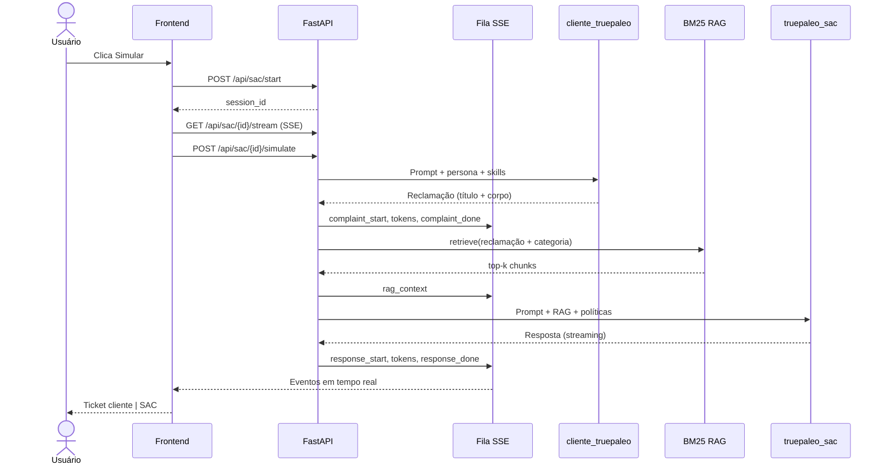
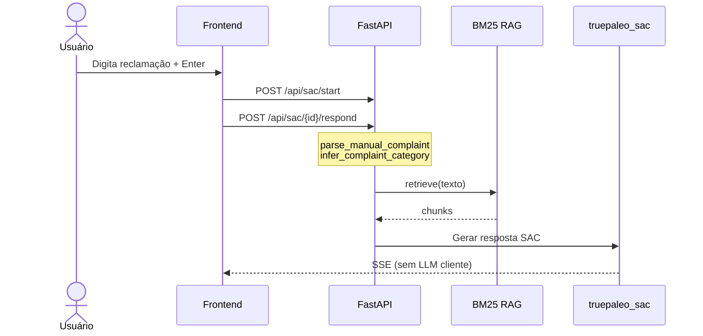

# TRUEPALEO SAC Simulator — Guia didático

## O que é este sistema?

É um **laboratório local** para treinar, testar e ajustar o atendimento SAC da marca **TRUEPALEO** (cosméticos naturais). Em vez de um chat genérico, ele simula um **ticket de reclamação** completo:

1. Um **cliente** (LLM) gera ou recebe uma reclamação no estilo Reclame AQUI
2. O sistema busca **contexto relevante** na base de conhecimento (RAG)
3. O **SAC** (outro LLM) responde com empatia, políticas e tom da marca

Tudo roda na sua máquina: **FastAPI + React** no browser, **LM Studio** como motor de IA, **Markdown** como base de conhecimento.

---

## Problema que resolve (casos de uso)

| Situação | Como o sistema ajuda |
|----------|----------------------|
| Testar respostas SAC antes de ir para produção | Você simula dezenas de reclamações sem cliente real |
| Treinar/atualizar tom e políticas | Personas e skills em Markdown são editáveis na UI |
| Enriquecer respostas com histórico | RAG traz casos parecidos (atraso, reembolso, produto vencido…) |
| Comparar modelos LLM | Cliente e SAC podem usar modelos diferentes no LM Studio |
| Escrever reclamação específica | Modo manual: você digita a reclamação e o SAC responde |

**Quem usa:** time de produto, SAC, marketing ou quem desenvolve o assistente — não é o consumidor final.

---

## Dois modos de operação

### 1. Simulação automática (botão **Simular**)

- O LLM `cliente_truepaleo` inventa uma reclamação (categoria aleatória: atraso, reembolso, alergia…)
- Perfil + skills do cliente influenciam o texto
- SAC responde com RAG + skills configuradas

### 2. Reclamação manual (campo de texto + **Enter**)

- Você escreve a reclamação
- O sistema **pula** a geração pelo LLM cliente
- Inferência de categoria + RAG + resposta SAC seguem iguais

---

## Arquitetura em camadas

```mermaid
flowchart TB
    subgraph UI["Camada de interface (React)"]
        Setup[SimulacaoSetup<br/>perfis, modelos, skills]
        Thread[TicketThread<br/>reclamação + resposta]
        Know[KnowledgeManager<br/>CRUD .md]
        Stream[useSacStream<br/>SSE em tempo real]
    end

    subgraph API["Camada API (FastAPI :8765)"]
        Routes[/api/sac/*<br/>/api/knowledge/*<br/>/api/personas/*]
        Orch[orchestrator.py<br/>ciclo simulate / respond]
        Queue[Fila SSE por sessão]
    end

    subgraph Domínio["Camada de domínio"]
        Personas[personas/<br/>cliente + sac]
        RAG[rag/<br/>BM25]
        Prompts[prompts.py<br/>montagem de mensagens]
        Fallbacks[fallbacks.py<br/>textos PT se LLM falhar]
    end

    subgraph Dados["Persistência em arquivos"]
        MD1[knowledge/reclame_aqui/*.md]
        MD2[knowledge/policies/*.md]
        MD3[personas/**/*.md]
        CFG[config.yaml]
    end

    subgraph IA["Motor de IA (LM Studio :1234)"]
        LM1[cliente_truepaleo]
        LM2[truepaleo_sac]
    end

    UI --> Routes
    Stream --> Queue
    Routes --> Orch
    Orch --> Personas
    Orch --> RAG
    Orch --> Prompts
    Orch --> LM1
    Orch --> LM2
    RAG --> MD1
    RAG --> MD2
    Personas --> MD3
    API --> CFG
```

**Ideia central:** a UI não fala com o LM Studio diretamente. Tudo passa pelo **orquestrador**, que controla ordem, validação, RAG e eventos.

---

## Fluxo completo — simulação automática



---

## Fluxo — reclamação manual



---

## Peças importantes do código

| Peça | Função |
|------|--------|
| `backend/sac/orchestrator.py` | Cérebro do ciclo: simulate, respond manual, RAG, fallbacks |
| `backend/sac/prompts.py` | Monta prompts do cliente e do SAC; parse de reclamação |
| `backend/rag/retriever.py` | Índice BM25 in-memory; busca por similaridade lexical |
| `backend/rag/loader.py` | Lê `.md` com frontmatter; valida schema Reclame AQUI |
| `backend/personas/persona_store.py` | Carrega perfis/skills de `personas/cliente` e `personas/sac` |
| `backend/llm/lmstudio.py` | Cliente HTTP OpenAI-compatible para LM Studio |
| `frontend/src/hooks/useSacStream.ts` | Conecta SSE, atualiza ticket ao vivo |
| `config.yaml` | Modelos por role, limites de frases, parâmetros RAG |

---

## Personas e skills (comportamento configurável)

```
personas/
├── cliente/
│   ├── profiles/   → cliente_irritado, cliente_paciente, …
│   └── skills/     → mencionar_pedido, tom_emocional, …
├── sac/
│   ├── profiles/   → atendente_empatico, atendente_tecnico
│   └── skills/     → politica_reembolso, rastreio_entrega, …
└── defaults.yaml
```

- **Perfil** = voz e personalidade (prompt base)
- **Skill** = instruções extras por ciclo (ex.: citar número do pedido, aplicar política de reembolso)

Na UI você escolhe perfil + skills + modelo LM Studio para cada papel.

---

## RAG (Retrieval-Augmented Generation)

Não é um banco vetorial externo: é **BM25** (busca por palavras-chave) sobre arquivos Markdown.

```
knowledge/
├── reclame_aqui/   → reclamação + resposta SAC (estilo Reclame AQUI)
└── policies/       → políticas oficiais (entrega, reembolso, produtos)
```

Quando chega uma reclamação, o sistema:

1. Enriquece a query com a **categoria** (atraso, reembolso…)
2. Ranqueia chunks por relevância
3. Injeta os melhores trechos no prompt do SAC (referência de tom e solução, sem copiar literalmente)

---

## API principal

| Método | Rota | Descrição |
|--------|------|-----------|
| POST | `/api/sac/start` | Cria sessão com perfis, modelos e skills |
| POST | `/api/sac/{id}/simulate` | Ciclo automático (cliente LLM + SAC) |
| POST | `/api/sac/{id}/respond` | Reclamação manual → resposta SAC |
| GET | `/api/sac/{id}/stream` | Eventos SSE do ciclo |
| GET/POST/PUT/DELETE | `/api/knowledge/*` | CRUD da base RAG |
| POST | `/api/knowledge/reindex` | Reindexa BM25 |
| GET | `/api/personas` | Lista perfis e skills |
| GET | `/health` | Status LM Studio, RAG e features |

---

## Eventos SSE (o que a UI “vê”)

| Evento | Significado |
|--------|-------------|
| `complaint_start` | Ciclo iniciou |
| `token` | Pedaço de texto streaming (cliente ou SAC) |
| `token_replace` | Substitui texto inválido (fallback ou retry) |
| `complaint_done` | Reclamação finalizada |
| `rag_context` | Chunks usados pelo RAG |
| `response_start` | SAC começou a responder |
| `response_done` | Ciclo completo |
| `closed` | Stream encerrado |

---

## Stack tecnológica

| Camada | Tecnologia |
|--------|------------|
| Frontend | React, TypeScript, Vite, Vitest |
| Backend | Python 3.11+, FastAPI, Uvicorn |
| IA | LM Studio (API OpenAI-compatible) |
| RAG | rank-bm25, YAML frontmatter nos `.md` |
| Deploy local | `.app` macOS + `uvicorn` na porta 8765 |

---

## Resumo em uma frase

> **Laboratório local que simula reclamações TRUEPALEO e respostas SAC usando dois LLMs, personas editáveis e memória BM25 sobre casos e políticas — para testar qualidade de atendimento antes de expor ao cliente real.**

---

## Documentação relacionada

- [`SISTEMA.md`](SISTEMA.md) — referência técnica e fluxos
- [`CONTEXT.md`](CONTEXT.md) — índice do projeto
- [`../knowledge/README.md`](../knowledge/README.md) — schema dos arquivos RAG
- [`../README.md`](../README.md) — início rápido e instalação
