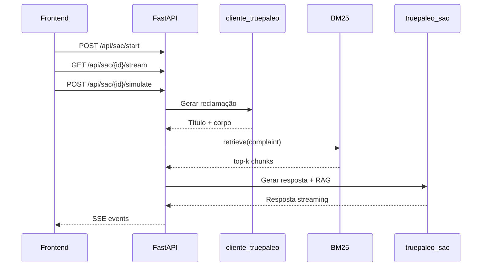

# Sistema TRUEPALEO SAC Simulator

## Visão geral

Aplicação local para simular ciclos de reclamação → resposta SAC da TRUEPALEO usando dois LLMs no LM Studio e base de conhecimento Markdown indexada com BM25.

## Fluxo de simulação



## Eventos SSE

| Evento | Descrição |
|--------|-----------|
| `complaint_start` | Início da geração da reclamação |
| `token` | Token streaming (role: cliente ou sac) |
| `complaint_done` | Reclamação finalizada |
| `rag_context` | Chunks BM25 recuperados |
| `response_start` | Início da resposta SAC |
| `response_done` | Ciclo completo |

## Personas

```
personas/
  cliente/profiles/   # arquetipos de reclamante
  cliente/skills/     # comportamentos por ciclo
  sac/profiles/       # voz do atendimento
  sac/skills/         # políticas e técnicas
  defaults.yaml
```

Skills são selecionadas por ciclo na UI antes de simular.

## RAG

- Diretório: `knowledge/reclame_aqui/` (reclamações + respostas) e `knowledge/policies/`
- Indexação: BM25 in-memory via `rank-bm25`
- Reindex: startup automático + botão na UI + após CRUD

## API principal

| Método | Rota |
|--------|------|
| POST | `/api/sac/start` |
| POST | `/api/sac/{id}/simulate` |
| GET | `/api/sac/{id}/stream` |
| GET/POST/PUT/DELETE | `/api/knowledge` |
| POST | `/api/knowledge/reindex` |
| GET | `/api/personas` |

## Desenvolvimento

```bash
PYTHONPATH=. uvicorn backend.main:app --reload --port 8765
cd frontend && npm run dev
```

Build produção: `bash scripts/build.sh` — serve SPA em `backend/static/`.
